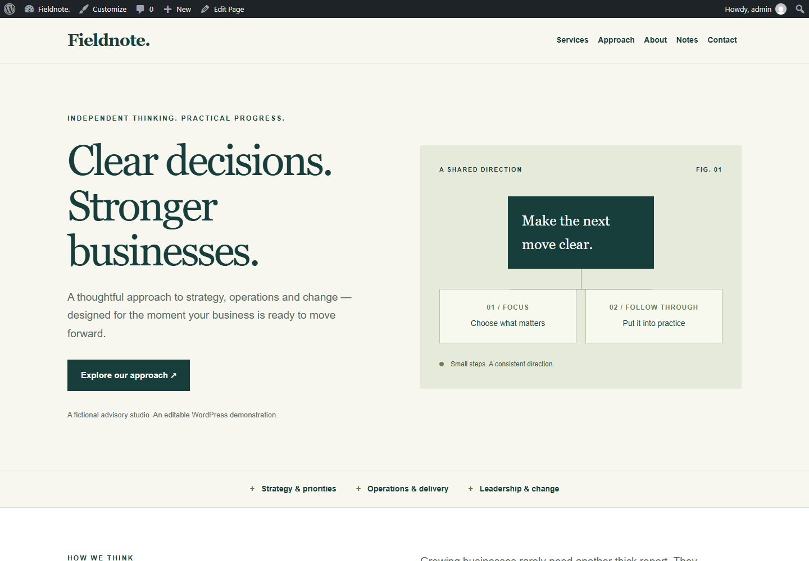

# Fieldnote — an editable Kadence website sample

A six-page, fictional consulting website built with **WordPress, Gutenberg, Kadence Theme and Kadence Blocks**. This is an independent GenesisOne portfolio demonstration, not a client engagement or a claim of business results.

[Open the interactive WordPress demo](https://playground.wordpress.net/?blueprint-url=https%3A%2F%2Fraw.githubusercontent.com%2FGenesisOnee%2Fkadence-consultancy-demo%2Fmain%2Fblueprint.json)

Playground creates a temporary WordPress installation in your browser. The first load downloads WordPress, the theme and the plugin. No account, purchase or installation on your computer is needed. Use the WordPress admin bar to edit a page. Changes affect your own temporary demo, not this repository.

## What is included

- Home, Services, Approach, About, Notes and Contact pages.
- Kadence rows, columns and headings, plus standard Gutenberg paragraphs and buttons.
- A shared desktop navigation and mobile menu.
- Responsive layouts, visible keyboard focus and reduced-motion support.
- An original HTML/CSS diagram with a text alternative. Its custom HTML is editable as code; the surrounding content uses ordinary editable blocks.
- A reproducible Blueprint and the page content, styles and generator used to build it.

There are no invented clients, testimonials, performance figures or stock portraits. Fieldnote is fictional. The contact page clearly routes project enquiries to the developer, GenesisOne.

## Versions and verification

| Component | Version |
|---|---|
| WordPress | 7.1.4 |
| PHP | 8.3 |
| Kadence Theme | 1.6.0 |
| Kadence Blocks | 3.9.0 |

The checks and exact Blueprint hash are recorded in [validation.json](validation.json). Screenshots come from the running WordPress demo. This sample uses Playground's SQLite integration; deployment on a conventional MySQL host requires separate staging and launch checks.

## Reproduce or adapt

1. Open the interactive demo above, or paste `blueprint.json` into WordPress Playground's **New → Write a Blueprint** screen.
2. Visit a page and choose **Edit Page** in the WordPress toolbar to inspect the blocks.
3. To modify the source, edit `content.json` or `site.css`, then run `node build-blueprint.mjs`. The generator uses Node's standard library and needs no packages.
4. Import the resulting Blueprint into a fresh Playground to test the complete build.

`compose-blocks.mjs` shows how the initial content was assembled using the public block-editor APIs after Kadence registered its blocks. `content.json` is the resulting serialized WordPress content. The Blueprint installs the pinned public theme/plugin releases and creates the six pages and navigation.

This is a demonstration, not a production hosting package. There is no analytics, payment checkout or working lead-capture form. A client launch would separately agree content, design, hosting, backups, form delivery, privacy requirements, licences and acceptance criteria.

For a similar website: [genesis@wizzardone.com](mailto:genesis@wizzardone.com).

## Licence

The original sample code and copy are MIT-licensed. WordPress and Kadence retain their respective licences; their software is downloaded from WordPress.org and is not included in this repository.
